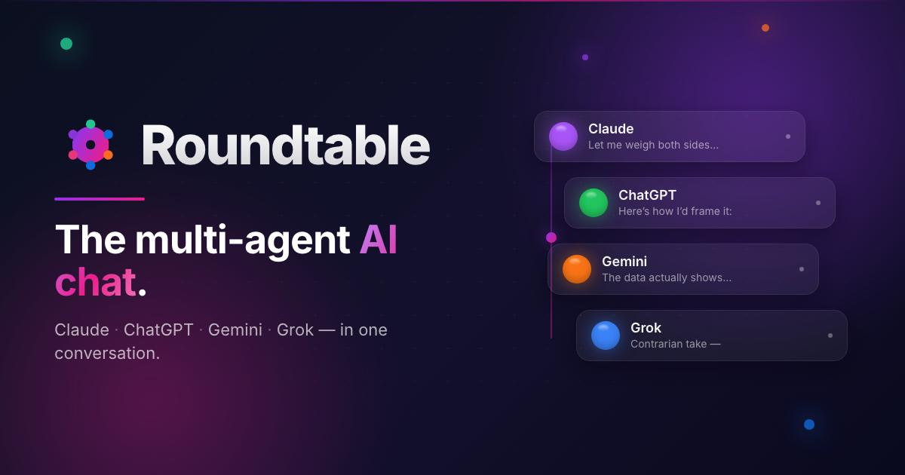

<p align="center">
  
</p>

# AI-Roundtable

질문 하나를 여러 AI(GPT · Claude · Gemini · Grok)에게 동시에 던지고, 서로 검토·반박·수정하게 한 뒤
**판정 AI가 하나의 통합된 최선의 의견**으로 정리해 주는 개인용 토론 도구입니다.

토론 과정을 구경하는 것보다 **통합된 결론**을 얻는 것이 목적입니다. 다수결로 뭉개지 않고, 실제로 합의되지 않았으면
`합의` / `조건부·부분 합의` / `미합의`로 솔직하게 표시합니다.

> **상태:** MVP 완성 — 백엔드(FastAPI, 테스트 134개)와 프론트엔드(Next.js, 테스트 62개).

## 어떻게 토론하나요

```
질문 ──▶ 1라운드: 참여 AI들이 서로를 보지 않고 독립 의견 작성 (병렬)
          │
          ▼
        2라운드~: 다른 참여자의 의견을 "참여자 A/B/C" 이름표로만 보고 검토·반박·수정
          │        (회사·모델 이름은 숨겨서 브랜드에 끌려가지 않게 함)
          ▼
        판정 AI가 매 라운드 평가: 수렴 / 진행 중 / 정체
          │
          ├─ 수렴 또는 정체 기준(기본 2회 연속) 도달 ──▶ 최종 통합 의견 작성
          └─ 사용자가 중단 ─────────────────────────▶ 그때까지의 의견으로 마무리
```

- **참여 AI 1~4개를 질문마다 고를 수 있습니다.** 1개만 고르면 판정 AI가 비평가 역할을 맡아
  "의견 → 비평 → 수정 → 평가" 순서로 진행합니다.
- **라운드 수 상한은 없습니다.** 판정 AI의 수렴·정체 판단이나 사용자 중단으로만 끝납니다.
- **무료 할당량이 떨어지면 어느 AI가 왜 소진됐는지 알려줍니다.** 참여 AI가 소진되면 그 AI만 빠지고 토론은 계속되며,
  판정 AI가 소진되면 다른 모델로 몰래 바꾸지 않고 **일시정지**합니다. 할당량이 돌아오면 이어서 재개할 수 있습니다.

## 비용 원칙: 추가 비용 0원

구독 없이 각 회사의 **무료 제공량(무료 등급·체험 크레딧)만** 씁니다. 유료 결제로 넘어가는 경로는 만들지 않았습니다.

| 슬롯 | 기본 회사 · 모델 | 환경변수 |
|---|---|---|
| 참여 1 | OpenAI · `gpt-4o-mini` | `OPENAI_API_KEY` |
| 참여 2 | Anthropic · `claude-haiku-4-5` | `ANTHROPIC_API_KEY` |
| 참여 3 | Google · `gemini-2.5-flash` | `GEMINI_API_KEY` |
| 참여 4 | xAI · `grok-3-mini` | `XAI_API_KEY` |
| 판정 | Google · `gemini-2.5-flash-lite` | `GEMINI_API_KEY` |

각 슬롯의 회사·모델은 설정(`PUT /slots/{id}`)에서 바꿀 수 있습니다. 체험 크레딧이 떨어진 슬롯은
OpenRouter의 `:free` 모델이나 Groq 같은 무료 대안으로 교체하세요(`OPENROUTER_API_KEY`, `GROQ_API_KEY`).
지원 회사: `openai`, `anthropic`, `gemini`, `xai`, `openrouter`, `groq`.

## 빠른 시작

> **경고: 서버에는 인증이 없습니다.** 혼자 로컬에서만 쓰는 MVP입니다. 반드시 `--host 127.0.0.1`로 실행하고,
> `0.0.0.0`으로 열거나 네트워크에 노출하지 마세요.

1. [uv](https://docs.astral.sh/uv/)를 설치하고 의존성을 받습니다.
   ```bash
   cd backend
   uv sync
   ```
2. `backend/.env.example`을 `backend/.env`로 복사하고, 각 회사 콘솔에서 발급한 무료 API 키를 넣습니다.
   키가 없는 슬롯은 선택할 수 없습니다. `.env`는 Git에 올라가지 않습니다.
3. (선택) 각 AI 연결을 확인합니다. **실제 API를 슬롯마다 1번씩 호출합니다.**
   ```bash
   uv run python -m roundtable.smoke
   ```
4. 서버를 실행합니다.
   ```bash
   uv run uvicorn roundtable.main:app --host 127.0.0.1 --port 8000
   ```
   API 문서: <http://127.0.0.1:8000/docs>
5. 다른 터미널에서 화면을 띄우고 브라우저로 **http://localhost:3000** 을 엽니다.
   ```bash
   cd frontend
   npm install
   npm run dev
   ```

## API 한눈에 보기

| 메서드 | 경로 | 설명 |
|---|---|---|
| `POST` | `/debates` | 토론 시작 (`question`, `slot_ids`) |
| `GET` | `/debates` | 토론 목록 |
| `GET` | `/debates/{id}` | 토론 상세 (라운드, 의견, 판정, 최종 결과) |
| `GET` | `/debates/{id}/events` | 진행 상황 실시간 스트림 (SSE) |
| `POST` | `/debates/{id}/stop` | 다음 라운드 전에 중단 |
| `POST` | `/debates/{id}/resume` | 일시정지·중단된 토론 재개 |
| `GET` / `PUT` | `/slots`, `/slots/{id}` | 슬롯 상태 조회, 회사·모델 변경 (API 키 값은 응답에 절대 포함되지 않음) |
| `GET` / `PUT` | `/config` | 정체 기준 등 설정 (정체 기준 1~10, 기본 2) |

시간 값은 UTC이며 끝에 `Z`가 붙습니다. 참여자가 1명인 토론의 1라운드처럼 평가를 건너뛴 라운드는 `judge_eval`이 `null`입니다.

## 테스트

```bash
cd backend
uv run pytest
```

자동 테스트는 **실제 API를 호출하지 않습니다.** 가짜 Provider와 `httpx.MockTransport`만 사용하므로 할당량을 쓰지 않습니다.

## 프로젝트 구조

```
backend/
  roundtable/
    providers/   회사별 API 연결 (OpenAI 호환, Anthropic, Gemini) + 오류 분류
    slots/       슬롯 상태 관리 (소진·한도 초과·자동 해제)
    usage/       사용량 기록과 일일 추정치
    debate/      프롬프트, 응답 형식, 호출·재시도, 토론 진행기, 이벤트 버스
    storage/     SQLite 저장소 (SQLModel)
    api/         FastAPI 라우트, SSE
  tests/         테스트 134개 (가짜 Provider 사용)
frontend/
  src/           Next.js 화면(app), 컴포넌트, API 클라이언트·SSE 훅(lib)
docs/superpowers/
  specs/         설계 문서
  plans/         구현 계획
```

자세한 설계는 [설계 문서](docs/superpowers/specs/2026-10-12-ai-roundtable-design.md)를,
백엔드 실행 세부 사항은 [backend/README.md](backend/README.md)를 참고하세요.

## 로드맵

- [x] 백엔드 MVP: 토론 진행, 판정, 소진 감지, 일시정지·재개, SSE
- [x] 프론트엔드 (Next.js): 질문 입력, 실시간 진행 화면, 최종 결과, 슬롯 설정
- [ ] 공개 서비스 확장: 로그인, 다중 사용자, PostgreSQL
